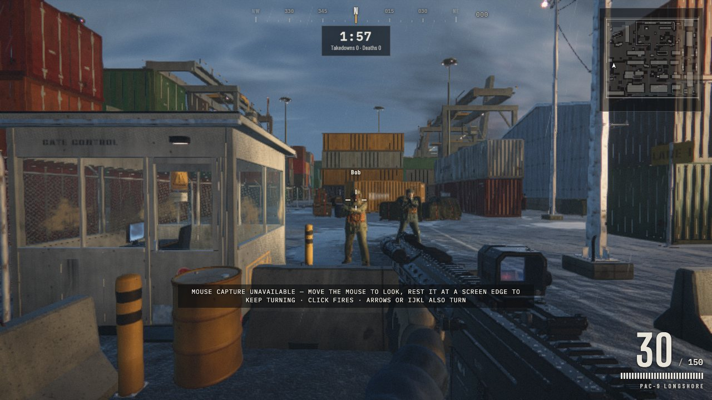
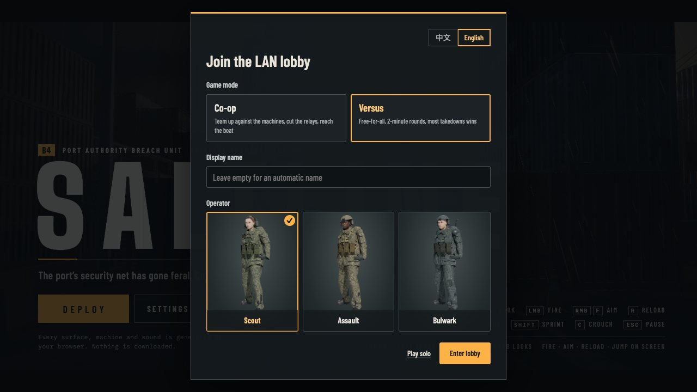
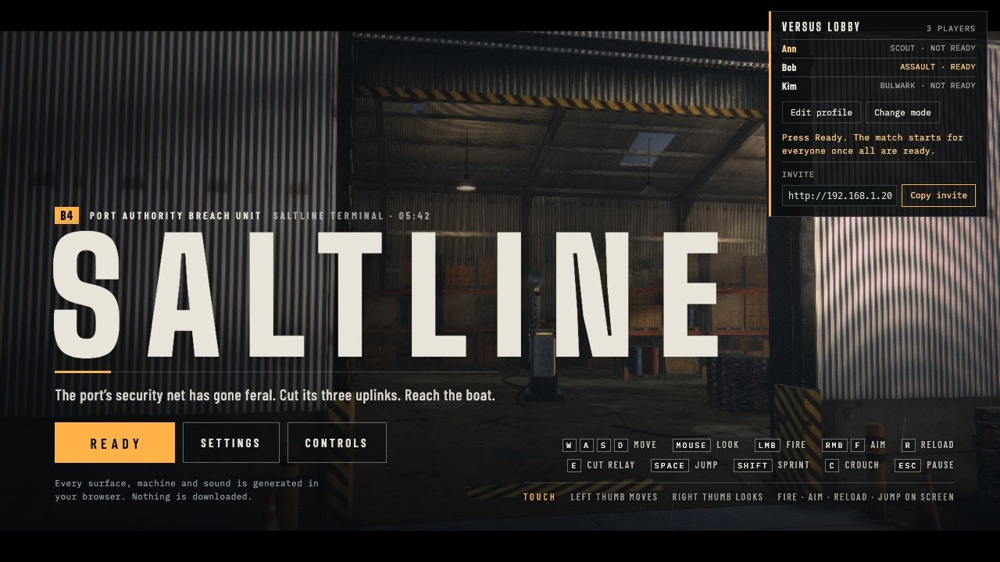

# Saltline LAN Multiplayer

**English** · [中文](README.zh-CN.md)

A first-person shooter you play in the browser with the people around you. One person runs one command and sends a link; everyone on the same Wi-Fi clicks it and is in the game. Nothing to install, no accounts, 2 to 8 players.



| First screen | Lobby |
| --- | --- |
|  |  |

## What this is

[*Saltline*](https://claude.ai/artifact/BGY1SztrAYcJQHSsnHHGmp) is a single-player browser shooter that Claude Fable 5.2 generated from one prompt in a run set up by Felix Rieseberg: a port whose security machines have gone feral. You go in alone, cut three relays and get out by boat. The whole game is one 1.4 MB HTML file that generates its world, machines and sound in the browser.

This project adds multiplayer on top of it, without changing that file:

- **Co-op**: go in as a team of up to 8 against the machines. Cut the relays together, cover whoever goes down, reach the boat.
- **Versus**: no machines, just each other. Everyone readies up, drops in at the same moment, and the most takedowns in 2 minutes wins.

## Why play it

- **Playing within a minute.** The host runs `node server.js`; everyone else only opens a link. No client, no sign-up, no game server outside your network.
- **Short rounds.** A versus round is 2 minutes, then back to the lobby. It fits a break.
- **Works on a laptop.** You can aim with `F`, so a trackpad is enough.
- **Chinese and English.** Each player picks a language; players using different languages share the same match.
- **Made for people in the same room.** Colleagues, classmates, flatmates: anyone on the same Wi-Fi or LAN.

## Quick start

You need [Node.js](https://nodejs.org) 18 or newer (developed and tested on Node 24). There are no other dependencies. Players only need a recent desktop browser.

**Easiest: one file.** Download `saltline.js` from the [latest release](https://github.com/henryjing96/saltline-multiplayer/releases/latest) and run it:

```sh
node saltline.js        # port 8080 by default; `node saltline.js 9000` for another
```

That file contains the whole game. On start it unpacks itself into the system temp folder and runs from there.

**Or from source:**

```sh
git clone https://github.com/henryjing96/saltline-multiplayer.git
cd saltline-multiplayer
node server.js          # port 8080 by default; `node server.js 9000` for another
```

Then:

1. Open `http://localhost:8080` on the computer running the server.
2. Pick a mode, a name and an operator.
3. Press **Copy invite** in the lobby and send it to people on the same network. The link opens the same room.

The game opens in Chinese. Switch to English on the first screen (the choice is remembered), or open `http://localhost:8080/?lang=en`. Single-player: `http://localhost:8080/?solo=1`.

## Modes

Co-op and versus are separate rooms, up to 8 players each.

**Co-op**

- Team up against the machines: cut the three relays, then reach the boat.
- The first player in the room is the host and presses Deploy to send the whole team in. The host simulates the machines and everyone else follows.
- Random landing and respawn sites. A downed player is back after 8 seconds; the mission fails when the whole team is down.
- The minimap shows teammates, relays and the extraction point.

**Versus**

- Free-for-all, no machines and no objectives.
- A match needs at least 2 players, all of them ready. After a 3-second countdown everyone drops in at the same moment, spread across the map.
- Rounds last 2 minutes and the most takedowns wins. After the results everyone returns to the lobby and readies up again.
- Players who arrive mid-round can join the running match. If only one player is left, the round is settled at once.
- 28 damage to the body, 61.6 to the head, 100 health. Respawn after 3 seconds, away from other players.
- Hold Tab for the scoreboard. The minimap shows only you; an opponent's name appears only under your crosshair with a clear line of sight.

## Controls

| Action | Input |
| --- | --- |
| Move / look | `W` `A` `S` `D` / mouse |
| Fire | Left button |
| Aim | Right button, or `F` (tap to toggle, hold to aim while held) |
| Reload / melee | `R` / `V` |
| Jump / sprint / crouch | `Space` / `Shift` / `C` |
| Cut relay (co-op) | Hold `E` |
| Scoreboard (versus) | Hold `Tab` |
| Pause | `Esc` |

`F` exists for trackpads, which cannot hold the right button, and for browsers whose mouse gestures take over right-click. Microsoft Edge does this by default; the lobby shows Edge users how to turn it off.

## How it works

- `original.html` is never modified. At startup the server patches a handful of exact anchors in the minified bundle in memory and injects the multiplayer scripts. If an anchor no longer matches, the server refuses to start and names it.
- The server is plain Node: static files plus a small hand-written WebSocket relay. No packages.
- The Chinese page is built from a translation table (`i18n-zh.js`) checked the same way, so a page shows one language only.
- Other players are skinned, animated operators loaded on demand: about 2.3 MB each, 7 MB for all three.

| File | Purpose |
| --- | --- |
| `server.js` | HTTP server, WebSocket relay for the two rooms, page patching, language selection |
| `i18n-zh.js` | Chinese text for the original game, applied by the server |
| `multiplayer.js` / `multiplayer.css` | Networking, mode and language choice, invite link, other players, minimap, versus rounds |
| `mp-strings.js` | Multiplayer text in both languages |
| `operators.js` | Operator catalogue and procedural stand-in models |
| `operator-rig.js` | GLB operators: loading, animation blending, rifle IK |
| `spawn-points.js` | Landing sites |
| `operators/` | The three operator models, their preview images, the glTF loader |
| `tools/` | Offline model build (Blender `bpy`) and compression scripts, and `bundle.js`, which builds the single-file release (`node tools/bundle.js` writes `dist/saltline.js`); the source assets they need are not part of this repository (see [`operators/SOURCES.md`](operators/SOURCES.md) for where they come from) |

## Limits

- Hits are decided by the shooter's browser and there is no anti-cheat. The server has no accounts or authentication. This is meant for people you know on a local network; do not expose it to the internet as is.
- The server only accepts game connections from pages it served itself and caps message size, but it does not rate-limit players.
- The original page loads its fonts from Google Fonts. Where that is unreachable the browser falls back to system fonts.

## Licence and notice

- **The multiplayer code** (`server.js`, `multiplayer.js`, `multiplayer.css`, `mp-strings.js`, `i18n-zh.js`, `operators.js`, `operator-rig.js`, `spawn-points.js`, `tools/`) is released under the [MIT licence](LICENSE).
- **The operator models** are built from third-party assets under CC0 1.0, CC BY 4.0 and MIT. Authors and licences are listed in [`operators/SOURCES.md`](operators/SOURCES.md); the CC BY 4.0 items require attribution when redistributed.
- **`original.html`** is the single-player game *Saltline*. It is not the work of this project. It was generated by Claude Fable 5.2 in a run set up by Felix Rieseberg (Anthropic), who shared it on [X on 9 November 2026](https://x.com/felixrieseberg/status/2119925633564463609); the original playable version is [this Claude artifact](https://claude.ai/artifact/BGY1SztrAYcJQHSsnHHGmp). All credit for the game goes to its author. No licence is granted for it here; it is included, unchanged by this project, only so that the multiplayer layer runs out of the box. **If you hold rights to it and want it removed, please open an issue and it will be taken down promptly.**
