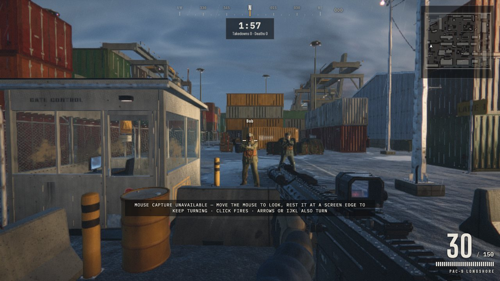
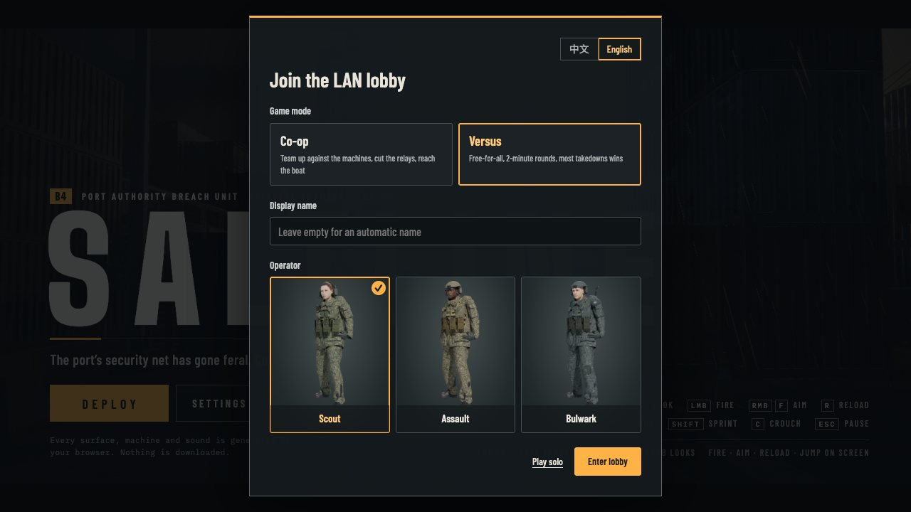
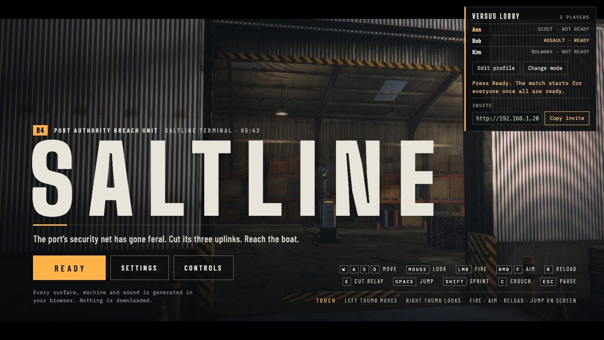

# Saltline 局域网多人版

[English](README.md) · **中文**

一个在浏览器里和身边的人一起玩的第一人称射击游戏。一个人运行一条命令、发出一个链接，同一 Wi-Fi 下的人点开就进入游戏。不用安装，不用注册，2 到 8 人。



| 首页 | 大厅 |
| --- | --- |
|  |  |

## 这是什么

*Saltline* 原本是一个单机网页射击游戏：一座港口的安保机器失控，你独自潜入，切断三个中继站，再坐船撤离。整个游戏只有一个 1.4 MB 的 HTML 文件，场景、机器和声音都在浏览器里实时生成。

本项目在不改动这个文件的前提下，给它加上了多人联机：

- **协作模式**：最多 8 人组队对抗机器。一起切断中继站，掩护倒地的队友，一起撤离。
- **对战模式**：没有机器，只有彼此。全员准备后同时进场，2 分钟内击倒数最多的人获胜。

## 为什么值得玩

- **一分钟开打**：开房的人运行 `node server.js`，其他人只需要点开链接。没有客户端，没有账号，也不依赖外部游戏服务器。
- **一局很短**：对战 2 分钟一局，打完回大厅，适合休息时间来几局。
- **笔记本就能玩**：可以用 `F` 键瞄准，只有触控板也够用。
- **中英文都有**：每个人各选各的语言，不同语言的玩家可以同场游戏。
- **为同一个房间里的人而做**：同事、同学、室友，只要在同一个 Wi-Fi 或局域网里。

## 快速开始

需要 [Node.js](https://nodejs.org) 18 或更新版本（开发和测试用的是 Node 24），没有其他依赖。玩家只需要一个较新的桌面浏览器。

```sh
git clone https://github.com/henryjing96/saltline-multiplayer.git
cd saltline-multiplayer
node server.js          # 默认端口 8080，换端口写成 node server.js 9000
```

1. 在运行服务器的电脑上打开 `http://localhost:8080`。
2. 选择模式、名字和角色。
3. 在大厅里点“复制邀请”，发给同一网络里的人。对方点开链接就进入同一个房间。

游戏默认中文，可以在首页切换成英文（会记住选择），也可以直接打开 `http://localhost:8080/?lang=en`。单人游玩：`http://localhost:8080/?solo=1`。

## 模式

协作和对战是两个互相独立的房间，各自最多 8 人。

**协作模式**

- 组队对抗机器：切断三个中继站，然后登船撤离。
- 第一个进入房间的人是房主，由房主点“部署”让全队出发。机器由房主的浏览器模拟，其他人同步显示。
- 出生点和复活点随机。倒地 8 秒后复活，全员倒地则任务失败。
- 小地图显示队友、中继站和撤离点。

**对战模式**

- 个人混战，没有机器，也没有任务目标。
- 至少 2 人，且所有人都点了“准备”才开始。3 秒倒计时后全员同时进场，分散在地图各处。
- 2 分钟一局，击倒数最多者获胜。结算后全员回到大厅，重新准备才开下一局。
- 对局中途进来的人可以直接加入当前这局。对局中只剩 1 人时立即结算。
- 身体一枪 28，头部 61.6，生命 100。被击倒 3 秒后在远离其他玩家的位置复活。
- 按住 Tab 看计分板。小地图只显示自己；对手的名字只在准星对准且没有遮挡时出现。

## 操作

| 动作 | 按键 |
| --- | --- |
| 移动 / 视角 | `W` `A` `S` `D` / 鼠标 |
| 开火 | 鼠标左键 |
| 瞄准 | 鼠标右键，或 `F`（短按切换，长按保持） |
| 换弹 / 近战 | `R` / `V` |
| 跳跃 / 冲刺 / 下蹲 | `Space` / `Shift` / `C` |
| 切断中继站（协作） | 按住 `E` |
| 计分板（对战） | 按住 `Tab` |
| 暂停 | `Esc` |

`F` 键是为两种情况准备的：触控板没法按住右键；有些浏览器的鼠标手势会占用右键。Microsoft Edge 默认开启鼠标手势，检测到 Edge 时大厅会提示如何关闭。

## 实现方式

- `original.html` 始终不修改。服务器启动时在内存里对压缩后的代码做几处精确替换，并注入联机脚本。任何一处对不上原文，服务器会拒绝启动并指出是哪一处。
- 服务器是纯 Node：静态文件加一个手写的 WebSocket 中继，不依赖任何第三方包。
- 中文页面由翻译表（`i18n-zh.js`）生成，采用同样的校验方式，所以一个页面只会出现一种语言。
- 其他玩家是带骨骼动画的蒙皮人物，按需加载：每个约 2.3 MB，三个共 7 MB。

| 文件 | 作用 |
| --- | --- |
| `server.js` | HTTP 服务、两个房间的 WebSocket 中继、页面替换与注入、语言选择 |
| `i18n-zh.js` | 原作文字的中文翻译表，由服务器套用 |
| `multiplayer.js` / `multiplayer.css` | 联机逻辑、模式与语言选择、邀请链接、其他玩家显示、小地图、对战回合 |
| `mp-strings.js` | 联机界面的中英文文案 |
| `operators.js` | 角色目录与程序化占位模型 |
| `operator-rig.js` | GLB 角色：加载、动画混合、持枪 IK |
| `spawn-points.js` | 出生点 |
| `operators/` | 三个角色模型、选角图、glTF 加载器 |
| `tools/` | 离线建模脚本（Blender `bpy`）和模型压缩脚本；所需素材不在本仓库内（来源见 [`operators/SOURCES.md`](operators/SOURCES.md)） |

## 限制

- 命中由开枪一方的浏览器判定，没有防作弊。服务器没有账号和鉴权。本项目面向局域网里的熟人，不要原样暴露到公网。
- 服务器只接受它自己提供的页面发起的游戏连接，并限制了单条消息的大小，但没有对玩家限速。
- 原作页面从 Google Fonts 加载字体，访问不到时浏览器会回退到系统字体。

## 许可与声明

- **联机部分的代码**（`server.js`、`multiplayer.js`、`multiplayer.css`、`mp-strings.js`、`i18n-zh.js`、`operators.js`、`operator-rig.js`、`spawn-points.js`、`tools/`）以 [MIT 许可](LICENSE)发布。
- **角色模型**由第三方素材制作，素材许可为 CC0 1.0、CC BY 4.0 和 MIT。作者和许可见 [`operators/SOURCES.md`](operators/SOURCES.md)；其中 CC BY 4.0 的素材在再分发时须保留署名。
- **`original.html`** 是单机游戏 *Saltline* 原作，不是本项目的作品。它取自公开渠道，本项目不清楚其作者，也不对它授予任何许可；放在仓库里只是为了让联机部分可以直接运行，文件本身未作修改。**如果你是权利人并希望移除，请提交 issue，我们会尽快下架。**
